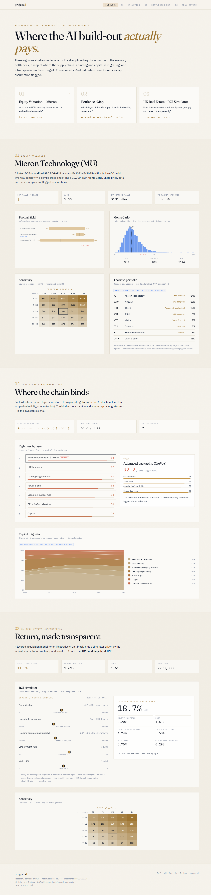
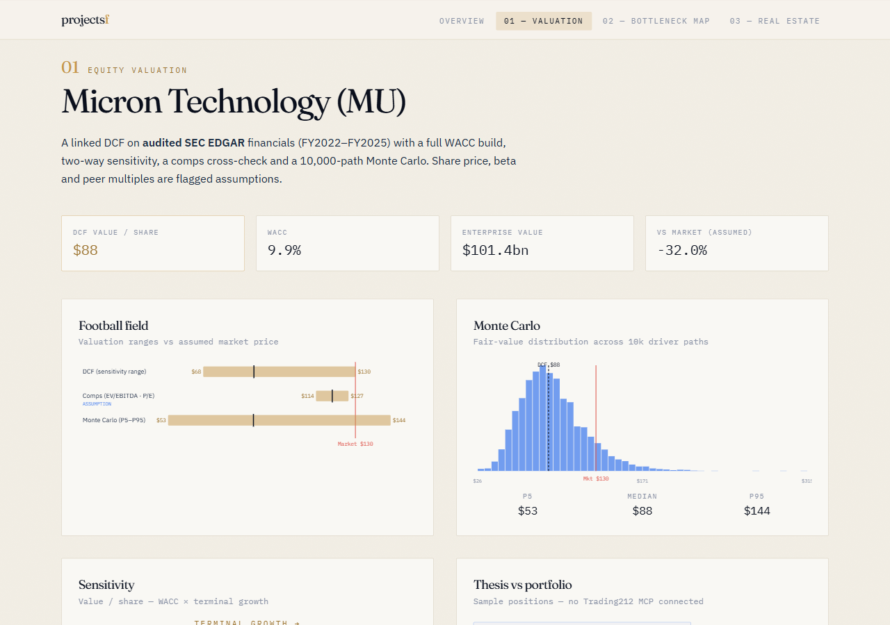
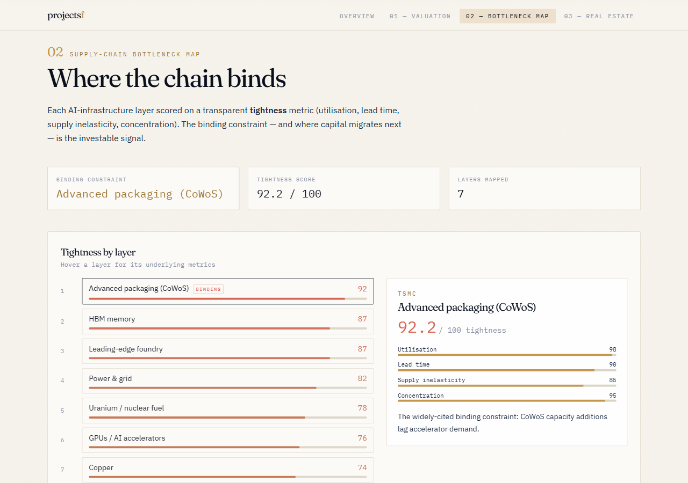
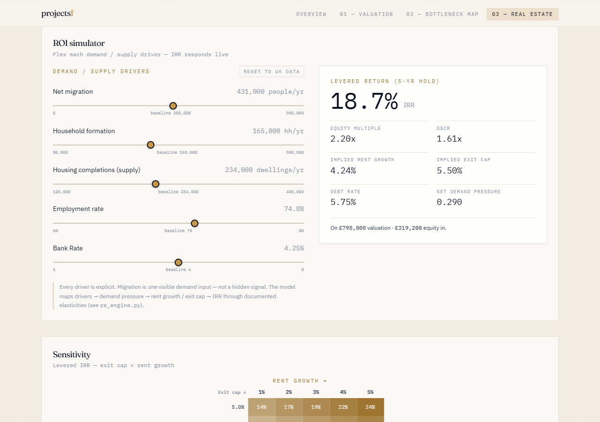

# projectsf — AI-Infrastructure & Real-Asset Investment Research Platform

> One runnable repo, three rigorous investment-research projects, unified by one institutional
> web dashboard. Built to a standard a senior investment professional would recognise.

**Thesis:** the returns from the AI build-out accrue less to the model companies and more to the
physical **bottlenecks** that gate compute — memory, advanced packaging, power, and the raw
materials beneath them — and, in parallel, to the **real assets** whose value is set by
transparent demand/supply fundamentals. This platform **values** one node in that chain,
**maps** where the chain is tight, and **underwrites** a real asset on first-principles drivers.

---

## The three projects
1. **Equity Valuation Engine (`/valuation`)** — linked 3-statement model + DCF (WACC build +
   sensitivity) + comps for **Micron (MU)**, with a Python Monte Carlo on the value drivers.
   Built on **audited SEC EDGAR** financials.
2. **Bottleneck Map (`/bottleneck_map`)** — interactive map of the AI-infra supply chain
   (GPUs → HBM → CoWoS packaging → power & grid → copper/uranium), scoring each layer on a
   transparent **tightness** metric and showing where capital migrates upstream.
3. **UK Real-Estate Underwriting + ROI Simulator (`/real_estate`)** — a property acquisition
   model (IRR / equity multiple / two-way sensitivity) plus a **transparent ROI simulator**
   driven by real demand/supply indicators (net migration, household formation, completions,
   rates). Every driver is visible and adjustable — not a black box.

See **`projects.md`** for full descriptions and each project's Definition of Done.

## Dashboard
One cohesive institutional design system (deep navy/slate + a single gold accent; Fraunces +
IBM Plex). Static-exported Next.js — deploys to GitHub Pages / Vercel with no server.



| Valuation | Bottleneck Map | Real-Estate ROI simulator |
|-----------|----------------|---------------------------|
|  |  |  |

**Why this stack:** static-export Next.js + Tailwind gives institutional polish and zero-infra
hosting for a public portfolio; the DCF sensitivity and the ROI simulator recompute **client-side
in TypeScript** (ported formula-for-formula from the Python engines, verified to match to 4 dp) so
a reviewer can flex assumptions live — no backend required.

## Architecture
```
        SEC EDGAR / market MCPs        HM Land Registry + ONS
                  │                            │
        financial-data-fetcher        uk-property-data   (custom skills, /skills)
                  │                            │
        ┌─────────┴───────────┬───────────────┴─────────┐
   /valuation           /bottleneck_map            /real_estate
   (Python + xlsx)      (Python scoring)        (Python + xlsx + TS)
        │                     │                        │
        └── JSON / PNG artifacts → dashboard/public/data ──┘
                              │
                    /dashboard  (Next.js + Tailwind, static export)
```
Python model layer computes + exports JSON/PNG; the Next.js dashboard renders them and
recomputes the DCF and ROI simulator **client-side** so reviewers can flex assumptions live.

## Run it
```bash
# 1) Python models (Anaconda Python 3.12)
pip install -r requirements.txt
python valuation/build.py        # MU 3-statement + DCF + Monte Carlo → xlsx + JSON + PNG
python bottleneck_map/build.py   # supply-chain tightness scoring → JSON
python real_estate/build.py      # UK underwriting model → xlsx + JSON
pytest -q                        # all calculation tests

# 2) Dashboard
cd dashboard && npm install && npm run dev   # http://localhost:3000
npm run build                                 # static export (GitHub Pages / Vercel)
```

## Data & honesty
All fundamentals are sourced (see **`DATA_SOURCES.md`**). Any value that could not be fetched is
a clearly-labelled **assumption / input** (blue in Excel, flagged in the UI) — never fabricated.

## Status
All three projects complete and verified; dashboard integrated. **42 Python tests pass**, both
Excel models audit with **zero formula errors** (and reconcile to the Python engines via
LibreOffice recalculation), and the dashboard builds to a static export. See **`PROGRESS.md`** for
per-project self-scores and **`CONCLUSIONS.md`** for the investment takeaways.

## License / data notices
UK data under the Open Government Licence (Land Registry, ONS). SEC EDGAR data is public domain.
This repository is a research/portfolio artifact, **not investment advice**.
